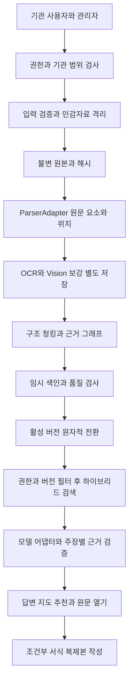
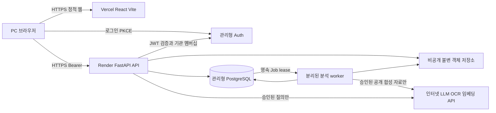

# 기술 구성과 데이터 처리 흐름

문서 갱신: 구조·기술 계약이 변경될 때 해당 절을 갱신한다. 진척도·완료 상태는 [TASKS](TASKS.md), 단계별 상세 보고·증거는 outputs에서 관리한다. 아래 기존 구현 기록은 보존하되 동일한 완료 이력을 추가로 반복하지 않는다.

## Phase 2C-1 구현 반영 2026-10-17

[청킹/검색 계약](docs/PHASE2C1_CHUNK_SEARCH.md)이 추가됐다. canonical source_blocks→순수 구조 chunker→영속 chunk_jobs→별도 chunk_worker→chunk_items/current 세대 원자 게시→SQLiteKeywordSearch 흐름이다. 기본 parsing schema2를 유지하고 schema_extensions(chunks,1)로 추가 모듈을 기록한다. 새 설정 세대/실패는 이전 정상 세대를 자동 대체하지 않는다. API·저장소·서비스·검색 어댑터를 분리하고 서비스에서 기관/활성/원본hash/현재 청크를 재검사한다. 실제 embedding/LLM·클라우드 및 전체 G1/G2는 미완료다.

## Phase 2B 구현 반영 2026-10-16

현재 로컬 파싱 구현은 [Phase 2B 계약](docs/PHASE2B_PARSING.md)이 기준이다. PDF/HWPX ParserAdapter와 SourceBlock/Anchor, schema v2의 parse_jobs·parse_attempts·source_blocks를 추가했다. 등록→영속 queued→별도 worker claim/lease→구조 재해결→전체 블록 원자 게시→명시 활성화 흐름이다. 만료된 시도는 새 worker가 자동 복구하고 stale 시도·다른 버전·등록 해제 후 게시를 거부한다. 기존 DB·원본·활성 포인터는 보존한다. HWPX XML 순서와 실제 화면 순서/페이지는 구별한다. 전체 G1/G2·실인증·AI·클라우드 완료가 아니다. 이하 Phase 2A와 이전 관찰은 각 시점의 범위로 보존한다.

## Phase 2A 구현 반영 2026-10-16

[로컬 백엔드 계약](docs/PHASE2A_BACKEND.md)이 현재 구현의 API·테이블·실패 복구·형식 한도 기준이다. apps/api의 HTTP→서비스→SQLite Unit of Work/불변 로컬 저장 어댑터를 구현했다. 원본 intent 선행 기록→배타 쓰기/해시→DB 게시, 실패/중단 시 비공개 보존·대사, 활성본 단일 포인터 전환을 사용한다. 처리 완료는 이번 자료 관리 단계의 무결성 검증 범위다. 파싱/AI 완료로 해석하지 않는다. 개발 SQLite만 실증했으며 기존 인터넷 운영 아키텍처·FR/WEB 및 G1-C 영속 클라우드 검증은 유지한다.

이하 ‘이전 실행환경 관찰’은 최초 문서 작성 시점의 이력이다. 현재 Git/main과 로컬 API가 있으며 과거 무저장소/무코드 설명을 현재 상태로 적용하지 않는다.

## 저장소 안정화와 현재 게이트

루트의 7개 문서가 단일 기준이다. [G1 A/B/C/D](docs/G1_GATES.md)가 개발/기능/배포/제출의 현재 진입 조건이며 이전 전체 G1 차단 설명보다 우선한다. 전체 G1 미완료와 개별 A 준비를 구별한다. 이번 변경은 사용자 지시에 따른 게이트 재분류이며 미실행 시험을 PASS로 바꾸지 않는다.

## 현재 운영 결정

공개 HTTPS 웹 URL과 PC 브라우저가 기본이다. URL 공개는 기관 자료/관리 API 공개를 뜻하지 않는다. 로컬 GPU·폐쇄망 모델·내부망 설치·Docker는 현재 선행 조건이 아니다. 기본 권고는 Vercel 정적 프런트 + Render FastAPI/API 및 별도 worker + Supabase 관리형 PostgreSQL/Auth/비공개 Storage다. 실제 계정·리전·플랜·배포는 미검증이며 생성하지 않았다. 비용/대안/출처는 [배포 전략](outputs/INTERNET_DEPLOYMENT_STRATEGY.md)을 따른다.

React 19.3.1·React DOM 19.3.1·TypeScript 7.0.2·Vite 8.3.4·React Flow 12.12.0·Python 3.12.14·FastAPI 0.143.2·Pydantic 2.14.1·Uvicorn 0.54.0의 기존 스파이크 결과를 유지한다. 개발 SQLite 3.53.1 PASS도 유지한다. PostgreSQL·Auth·객체 저장소는 인터넷 운영 영속성/권한을 위한 추가 어댑터이며 실증 전 채택 완료로 표현하지 않는다. 이전 후보 표는 검토 이력이며 현재 기본 권고가 우선한다.

상태: 인터넷망 웹앱 설계 v1.2. 기존 최소 스파이크 PASS 유지, 클라우드/실모델/브라우저는 미검증. 변경일 2026-10-16.

## 이전 실행환경 관찰과 현재 재검증 경계

현재 작업 폴더는 Git 저장소가 아니며 코드·의존성 파일이 없다. 초기에는 outputs/와 work/만 존재했다. 상위 Documents 및 Codex 위치와 현재 폴더에서 적용할 기존 AGENTS.md를 발견하지 못했다. Git 초기화·원격 설정은 수행하지 않았다.

| 관찰 | 결과 | 의미 |
|---|---|---|
| OS | Windows 11, 10.0.26200 | 현재 호스트 확인, 심사 환경은 미검증 |
| Git | 2.53.0.windows.3 실행 | 저장소/원격은 없음 |
| Node | 번들 v24.19.0 실행 | React 빌드 가능성만 있으며 실제 패키지 미설치 |
| pnpm | 번들 11.25.0 실행 | 저장소 의존성/lockfile 없음 |
| Python | 번들 3.12.14 실행 | 일반 PATH python은 WindowsApps 별칭이며 실행 실패 |
| npm / Docker | 현재 PATH에서 발견 못함 | 설치 부재를 단정하지 않음, Compose 실행 미검증 |
| GPU/메모리/브라우저/망/API 키 | 미검증 | 모델·OCR/설치·운영 사양 확정 불가 |

번들 실행환경은 Codex 내부 지원 도구로 확인한 것이며 심사위원 PC에 존재한다고 가정하지 않는다. 첨부 DOCX/HWPX는 번들 Python zip/XML 도구로 읽었고 원본 파일은 변경하지 않았다. 실행환경 확인은 앱 실행 검증과 구별한다.

| 영역 | 기술 후보 | 확정에 필요한 증거 |
|---|---|---|
| 웹 | React+TypeScript+Vite 또는 Next.js | 최소 빌드·한글/PDF 표시·클린 설치; SSR 필요 없으면 단순 구성을 우선 검토 |
| API/작업 | Python+FastAPI, 분리 가능한 작업 실행기 | 가상환경 설치·기동·취소/재시도·장시간 작업 검증 |
| 메타데이터 | SQLite 또는 PostgreSQL | 기관/버전 트랜잭션·백업/복구·독립 설치 검증 |
| 검색 | 벡터 저장 어댑터(Chroma/pgvector 후보)+BM25 계열 | 권한 필터·한국어 검색·차원 교체·일괄 전환 검증. FTS를 BM25와 동일시하지 않음 |
| 지도 | React Flow 또는 Cytoscape.js | 노드 선택/접근성 목록/라이선스 검증 |
| PDF/HWPX | 형식별 ParserAdapter | 표·캡처·읽기 순서·원문 앵커·안전성 시험 |
| OCR/Vision/LLM | 로컬 또는 정책상 승인된 엔드포인트 | 한글 품질·실제 접근·데이터 전송 조건·타임아웃/자원 실측 |
| 서식 | PDF 뷰어, rhwp 후보 어댑터 | 공식 기능/라이선스·1종 렌더/필드/저장/재열기 실증 |
| 실행 패키지 | Docker Compose 후보 + 필요 시 네이티브 스크립트 | 깨끗한 심사 대체 환경에서 실제 실행 |

Phase 1에서 정확 버전·공식 근거·라이선스·최소 실행 명령·채택/기각 이유를 이 절에 기록한다. 현재 특정 프레임워크/모델의 최신 지원 기능·라이선스·호환성을 검증했다고 주장하지 않는다.

## 경계와 흐름

업로드는 요청 처리와 파싱 작업을 분리한다. 작업 상태는 received→validated→parsing→enriching→indexing→ready 또는 failed/cancelled이며 단계·재시도 횟수·오류 구역을 기록한다. 같은 파일 해시+파서/모델 설정 재요청의 중복 작업을 제어하고, 실패 중간 산출물을 활성 검색에 게시하지 않는다. 대규모 메시지 브로커는 필수 선택이 아니다.

문서 교체는 새 불변 버전을 staging으로 처리한 후 메타데이터의 활성 스냅샷을 전환한다. 실패하면 이전 활성본을 유지한다. 명시적 등록 해제는 즉시 serving 허용목록에서 제외한다. 벡터DB 정리가 늦어져도 응답 직전 활성 스냅샷·권한을 재검사하여 옛 답변을 차단한다. 대화 캐시·지도·추천·초안 근거에도 같은 무효화 세대를 사용한다. 이전 답변을 다시 열면 옛 버전/현재 무효 경고를 표시하고 현재 안내로 재사용하지 않는다.

원본 보존과 등록 해제를 분리한다. 원본 저장 경로는 업로드 ID/해시로 생성하고 사용자 경로를 신뢰하지 않는다. 생성물은 별도 경로에 저장하며 원본은 읽기 전용이다. 정정된 추출문은 correction layer로 저장하고 공식 규정 개정으로 표시하지 않는다. 이전 원본은 관리자 이력에서만 접근 가능하며 직원 검색은 활성본만 사용한다.

## 도메인 데이터 계약

[Phase 2D-3](docs/PHASE2D3_OFFLINE_DISCOVERY.md)는 입력 snapshot 전체 순회→명시 표식 기반 deterministic offline adapter→strict 구조/근거/처리 범위 검증→DRAFT/NEEDS_REVIEW DTO를 추가한다. 기존 WorkflowExtractionAdapter.extract 반환형은 유지하고 coverage receipt 확장을 분리한다. 담당 역할은 별도 근거 후보이며 인증 권한으로 쓰지 않는다. 새 DB/HTTP/승인/게시/UI는 추가하지 않는다.

[Phase 2D-1~2](docs/PHASE2D_INPUT_CONTRACT.md)는 기존 RAG 반환형을 유지하고 별도 WorkflowExtractionAdapter·strict 후보 스키마·명시 구형 근거 bridge·관리자용 입력 snapshot을 추가한다. snapshot은 원본 재파싱/전체 청크 재구성으로 무결성을 검사하고 입력 세대·진척을 분리한다. DB migration/새 HTTP 경로/실모델/승인·게시/UI는 추가하지 않는다. 구조/근거 연결과 의미 검토는 별개이며 의미 상태는 NOT_VERIFIED다.

| 엔티티 | 최소 필드/관계 |
|---|---|
| Workspace/Actor | 기관 ID, 역할, 허용 공개 기본팩, 자료 범위 |
| Document/DocumentVersion | 논리 문서 ID, 버전 ID, SHA-256, 원본 참조, 기관, 분류/지위, 적용기간, 등록/활성 상태 |
| SourceElement | 요소 ID, 버전 ID, 종류, 읽기 순서, 부모 절, 원문 텍스트, asset_ref, location |
| ImageAnnotation | 이미지 요소 ID, OCR 텍스트/신뢰도, AI 설명, 인접 요소, 모델/프롬프트 버전, 확인 상태 |
| Chunk/IndexGeneration | 요소 ID 목록, 검색 표현, 원문/보강 구분, 기관/기간/버전, 청크 해시, 임베딩 모델/차원/세대 |
| WorkNode/WorkEdge | 업무/단계/조건/제출/서식/참고 유형, 관계, 근거 목록, 후보/확인/충돌 상태 |
| FormTemplate/Draft | 원본 버전, 관련 업무·단계, 필드 매핑, 호환성, 입력 출처, 생성본/원본 구분 |
| Issue/ChangeEvent/Job | 근거 충돌·영향 대상·조치, 변경자/시각/전후 버전/결과, 작업 상태·실패 구역 |
| AnalysisResult/Claim/EvidenceRef | 결과 종류, 주장, 모델/설정 버전, 근거, 검증/불확실성, 활성 스냅샷 |

EvidenceRef = 기관 ID + 문서/버전 ID + 요소 ID + location + 근거 유형. PDF location은 실제 페이지(1부터)·bbox·원문 이미지 참조다. HWPX는 section/문단/표·셀/그림 참조와 XML 경로를 사용한다. 검증된 렌더 대응이 없으면 HWPX 페이지 번호를 만들어내지 않고 해당 구역·요소/이미지로 이동한다. source_kind는 original_text / original_image / ocr / ai_description / user_correction / user_input을 구별한다.

모든 AI 결과는 주장별 evidence_refs, generated_by(model/version/prompt), status, uncertainty를 가진다. 조회 가능한 원문 근거가 없는 결과는 unverified candidate로만 보관하며 사용자 사실 답변·확정 지도에서 제외한다. 사용자 입력 필드는 입력 출처와 확인 여부를 표시한다. 그림 설명은 이미지와 인접 본문으로 연결하고 의무·기한의 단독 근거가 되지 않는다. Citation resolver는 파일 경로를 직접 노출하지 않고 권한 검사 후 원문 위치를 연다.

지식 그래프는 관계형 테이블로 표현 가능한 논리 모델이다. 별도 그래프DB나 완성형 노트앱은 필수가 아니다. Markdown은 중간 표현/내보내기이며 유일한 진실 저장소로 사용하지 않는다.

## 모델 및 인프라 교체 계약

- ParserAdapter.parse(readonly_asset) → SourceElement[] + warnings.
- OCRAdapter.recognize(image) → text + boxes + confidence.
- VisionAdapter.describe(image, adjacent_elements, ocr) → 관찰 설명 + EvidenceRef[].
- GenerationAdapter.generate(context, output_schema) → 구조화 Claim/Map 후보. 공급자 응답은 스키마 검증을 통과해야 한다.
- EmbeddingAdapter.embed(texts) → vectors + model_id + dimension. 모델/차원 변경은 전체 재색인·새 세대 검증 후 전환하며 기존 벡터와 혼합하지 않는다.
- RetrievalAdapter.search(query, authorized_scope, active_generation) → 근거 후보. 권한 필터를 검색 전 적용하고 응답 전 재검사한다.
- FormAdapter.preview/inspect_fields/fill_copy → 프리뷰/필드 계약/별도 초안. 실패 시 원본 다운로드와 호환성 경고.

설정에는 provider, endpoint, model_id, embedding_model/dimension, timeout, retry_limit, outbound_allowed를 둔다. 비밀은 환경/비밀 저장소로 주입한다. 공급자별 SDK·응답 타입은 어댑터 내부로 제한하고 오류를 timeout/rate_limit/unavailable/invalid_output 등 공통 상태로 변환한다. 타임아웃/호출 한도는 Phase 1에서 수치화한다. 자동 공급자 전환은 데이터가 다른 외부 서비스로 이동할 수 있으므로 기본 비활성이다. mock 모델은 계약 테스트에만 사용한다.

## 안전·복구와 심사 실행

모든 API·다운로드·작업·검색은 기관/역할 검사를 통과해야 한다. MIME/시그니처, 확장자, 압축폭탄·zip slip, PDF 능동 콘텐츠, 요청/파일 크기 및 시간 한도를 검사한다. HWPX 압축은 제한된 읽기만 수행한다. 입력 문서의 지시문으로 시스템 프롬프트·권한·파일 실행이 바뀌지 않아야 한다. 원문/이미지/개인정보/키는 일반 로그에 기록하지 않는다.

공개·합성 자료를 기본팩으로 제공하고 자료 출처·버전·허용 범위를 기록한다. 폐쇄망 인증은 현재 MVP 대상이 아니다. 인터넷 공개 운영의 인증·영속성·보안과 심사 독립 실행은 미검증이다. 백업은 메타DB·원본·설정 참조를 함께 다루고 색인은 재구축 가능하게 한다. 복구 후 해시·활성 세대·권한 검증을 다시 수행한다.

제출 패키지는 개발자 로컬 경로 없이 설치 가능한 소스·잠금파일·환경 예제·비민감 샘플·모델별 설정 안내·알려진 제약·라이선스를 포함한다. 심사위원이 직접 키를 넣거나 승인된 실제 모델에 연결하는 절차가 필요하다. 오프라인 계약 모드는 제공 가능하지만 실제 AI 구동의 대체 증거로 쓰지 않는다. 실행 명령과 접속주소는 Phase 1/6 실증 후 README에 작성한다.

## 인터넷망 배포 연결

공개 URL은 소개/로그인/명시적 공개 합성 예시를 제공한다. 기관 자료는 로그인 후만 접근한다. 직원은 자기 기관 활성 자료 조회, 자료관리자는 같은 기관 등록/교체/해제, 운영자는 운영 설정/감사 권한을 가진다. 전 기관 자료 조회 권한을 운영 역할에 묵시 부여하지 않는다. 공급자 서비스 관리키가 RLS를 우회할 수 있으므로 서비스 키를 보유한 API/worker도 애플리케이션 수준 기관 검사를 생략하지 않는다.

Supabase Auth 등 관리형 인증을 후보로 두고 JWT 서명·issuer·audience·exp를 서버에서 확인한 후 DB의 활성 멤버십·역할로 기관 범위를 구한다. 클라이언트가 보낸 tenant_id를 그대로 신뢰하지 않는다. 프런트는 Auth 공개 URL/공개키만 사용 가능하며 LLM·DB·Storage 서비스 비밀은 절대 포함하지 않는다. Access token은 짧은 수명·메모리 보관을 우선하고 브라우저 지속 저장은 기본 비활성으로 설계한다. 쿠키를 선택하는 후속 구현은 Secure/HttpOnly/SameSite와 CSRF/Origin 검증을 별도 시험한다.

기본 경로는 HTTPS API에 Authorization Bearer를 보내는 방식이다. production CORS는 확정한 프런트 정확 origin만 허용하고 credential wildcard를 사용하지 않는다. dev localhost와 승인된 staging은 분리 설정/DB/키를 사용한다. Vercel 임의 preview origin은 production 허용목록에 자동 추가하지 않는다. SPA의 깊은 경로 새로고침·로그인 callback과 CSP를 검증한다.

## 영속 저장과 파일 DB 일관성

개발은 SQLite+로컬 별도 원본 디렉터리를 유지한다. 클라우드는 관리형 PostgreSQL과 비공개 객체 저장소를 사용하며 인스턴스/컨테이너 디스크는 임시 작업에만 쓴다. 기본 provider 후보는 Supabase이며 ObjectStoreAdapter/AuthAdapter/MetadataRepository로 제품 모델과 분리한다. PostgreSQL migration·pool/TLS·권한/RLS·백업은 신규 검증 대상이다. NumPy exact cosine은 회귀 기준으로 보존하고 클라우드 임베딩 저장/pgvector 여부는 실제 모델 차원·한국어 검색·규모 시험 후 결정한다. 로컬 임베딩 파일을 단독 영속 인덱스로 운영하지 않는다.

DB와 객체 저장소에는 분산 트랜잭션이 없다고 전제한다. 다음 게시 프로토콜을 사용한다.

1. 인증/기관/한도/공개자료 확인 후 멱등 upload_id와 DB pending 등록을 만든다. 파일은 서버가 생성한 기관/버전/UUID 키로 격리된 비공개 영역에 저장한다. 경로/파일명을 사용자 입력으로 조합하지 않는다.
2. 길이·실제 형식·압축 한도·해시와 접근 가능성을 검증한 뒤 immutable object_id/hash를 DB에 기록한다. 객체 저장 실패 또는 DB commit 실패는 published로 보이지 않는다.
3. Job과 처리 상태/이벤트를 DB 트랜잭션으로 생성한다. API는 202+job_id를 반환한다. worker는 lease/heartbeat·재시도 횟수·멱등 키로 작업을 취득하고 종료 후 복구 가능해야 한다. 단일 FastAPI BackgroundTasks/메모리 큐만으로 접수 성공을 보장하지 않는다.
4. 파생 요소·청크·그림 설명·지도 후보는 새 세대 staging으로 쓰고 근거/권한/무결성 검사 후 하나의 활성 스냅샷을 전환한다. 교체 실패면 옛 활성본을 유지한다. 외부 임베딩 호출은 DB 트랜잭션 밖에서 수행한다.
5. 대사 작업은 pending/orphan 객체·누락 blob·DB/색인 세대 불일치를 찾아 경고/복구한다. 실패 원본을 조용히 삭제하지 않는다. 파생 캐시 재구축과 원본 폐기는 별도 정책이다.

등록 해제는 먼저 DB serving 권한/활성 세대를 차단하고 검색·지도·추천·대화 캐시·진행 중 생성의 응답 직전 검사를 적용한다. 원본 객체는 보존한다. 직원 원문/서식 다운로드는 인증된 API가 매 요청 권한/활성을 확인해 스트림하고 `Cache-Control: private, no-store`를 적용한다. 공개 bucket·영구 파일 URL·브라우저에 전달되는 장기 signed URL은 사용하지 않는다. 이미 사용자가 내려받은 사본까지 회수할 수 있다고 주장하지 않는다.

## 모델 연결과 근거 검증

인터넷 API 후보는 OpenAI `gpt-4.1-mini`와 Google `gemini-2.5-flash`다. 공식 문서에 존재하는 후보를 확인한 것이며 계정 사용 가능성/할당량/수명/한국어 성능·실제 교체는 미검증이다. 승인 후 동일 공개/합성 골드셋에서 2종을 실제 호출해 JSON schema, 텍스트/이미지 입력, refusal·timeout·429, 근거 의미 일치, 비용/지연을 비교한다. 한 공급자가 실패했다고 다른 외부 서비스로 자동 전송하지 않는다.

도메인 결과는 AnalysisResult/Claim/EvidenceRef로 통일하고 공급자 SDK는 adapter 내부로 제한한다. provider capability matrix에 schema dialect·이미지·reasoning·stream·오류/제한을 기록한다. 실제 모델명·가능하면 snapshot·프롬프트·데이터 버전을 로그의 비민감 메타데이터로 남긴다. 임베딩 모델 변경은 생성 모델과 분리해 차원/정규화/검색 세대 재구축 후 전환한다.

JSON 문법·타입·필수 필드/중복 ID/간선 대상 검사 → 문서/버전/기관/위치·인용 재해결 → 주장과 근거 의미 일치 검증을 분리한다. 모든 노드·간선·추천 이유·그림 설명·규정 필드에 근거를 연결하며 OCR/AI 보강만으로 기한·의무를 확정하지 않는다. HWPX는 manifest/spine 순서·중첩 셀 중복 방지·그림 resource ID·XML 앵커를 보존하고 실제 렌더로 시각 순서를 검증한다.

## 인터넷 보안 설정과 제한 초기안

아래 값은 합성 데모용 보수적 초기 설정안이며 실측 성능·플랫폼 제공 한도가 아니다. G1 부하 시험 후 조정하고 변경 이유를 기록한다.

| 항목 | 초기 설계값 |
|---|---|
| 업로드 | PDF/HWPX만, 파일당 20 MiB·한 번에 5개, PDF 100쪽까지 |
| 압축/파싱 | HWPX entry 1000개·전체 해제 200 MiB·팽창비 100배 초과 거부, XML 외부 엔티티 금지, 경로 이탈 금지 |
| 기관 저장 | 1 GiB/기관부터, 예약량 포함 DB 원자적 계수; 백업 저장량 별도 산정 |
| 요청 | 로그인 실패 IP당 5회/분, 검색 30회/분/계정, AI 5회/분·50회/일/계정, 기관 AI 200회/일 |
| 비용 | 최초 승인 요청안 $10/검증 세션, 운영 AI $10/일·$30/월 상한. 승인 전 실호출 0회 |
| 작업/모델 | worker 동시 분석 1, 모델 timeout 60초·추가 재시도 최대1회, 작업 10분 watchdog, 출력토큰 최대2048부터 검증 |
| 로그/백업 | 비민감 운영 메타 로그 14일·감사 메타 30일, DB/객체 일1회 별도 백업·복원 목표 RPO24h/RTO4h |

프런트뿐 아니라 서버/worker에서 한도를 강제한다. 요청·토큰 상한과 공급자별 최대 예상 비용을 사전 예약하고 성공/실패/재시도 비용을 정산한다. 공급자 과금과 시차가 있으므로 USD 상한의 완벽한 일치를 보장하지 않으며 최대 요청 크기/동시성·예약금·안전 여유로 초과를 억제한다. 로그에는 키·Authorization·원문·질문 전문·민감 파일명/개인정보·signed URL을 기록하지 않는다. IP rate-limit 값은 단기 메모리/해시로 처리하고 원 IP를 장기 로그에 남기지 않는다.

업로드 시 공개 출처·합성 여부를 확인하고 비공개·개인정보·키 패턴은 격리/거부한다. 자동 탐지는 완전하지 않으므로 관리자 확인과 허용 corpus 중심으로 제한한다. 자료 내 지시·링크를 권한/도구 실행으로 전환하지 않는다. 원격 URL 가져오기·외부 엔티티·임의 코드/명령 실행은 비활성이다. PDF/문서 프리뷰와 생성 Markdown은 능동 콘텐츠·XSS 방어/CSP·격리 렌더를 적용한다.

## 백업 저장기간과 승인 경계

DB 백업만으로 파일 백업이 된다고 가정하지 않는다. 객체 별도 복제/해시 manifest와 DB 스냅샷의 공통 시점을 기록하고 복원 후 해시·기관 권한·등록 해제 tombstone·활성 세대를 재검사한다. 복원 때문에 해제 자료가 다시 노출되면 실패다. 백업도 비공개·최소권한/암호화·접근감사를 적용한다.

저장기간 제안은 제출일 이후 30일까지(2026-12-11) 시연 원본·파생 데이터를 보존하고 이후 접근 중지/담당자 통지하는 것이다. 결선/행사 일정·심사 요청에 따라 담당자가 확정하며 자동 원본 삭제는 구현하지 않는다. 파생/임시 데이터와 로그는 승인된 보관 정책으로 정리하되 원본 수정·이동·삭제 금지는 유지한다. 원본·백업 영구폐기는 별도 명시 승인과 범위/복구 불가 안내 후만 수행한다. 원본 object key 변경도 원본 이동으로 취급해 승인 없이 하지 않는다.

## 배포와 심사 재현 경로

기본 배포는 Vercel에 Vite 정적 산출물, Render에 FastAPI와 별도 worker, Supabase PostgreSQL/Auth/비공개 Storage다. DB migrations는 배포 전 독립 단계, API health/readiness와 worker lease 복구를 확인한다. production/staging의 키·DB·bucket·origin을 분리한다. Cloud Run은 클라우드 소스 빌드가 가능한 대안이며 현재 PC Docker 부재와 별개다. scale-to-zero에서 요청 종료 후 임의 백그라운드 작업을 보장하지 않으므로 Tasks/Jobs 등 별도 영속 작업 실행 경로와 비용 검증이 필요하다.

현재 운영 URL·리소스·키·마이그레이션/실행 스크립트는 없다. 구성 변수 계약은 API_BASE_URL/Auth 공개 설정(프런트)과 DATABASE_URL/DB_POOL_URL/AUTH_ISSUER/AUTH_AUDIENCE/ALLOWED_ORIGINS/STORAGE_URL/비공개 bucket·관리키/LLM_PROVIDER/모델별 API 키/EMBEDDING_MODEL/예산 한도(서버)다. 값은 실제 시크릿 관리 기능으로만 입력한다.

독립 심사는 공개 URL·평가자 계정 시연과 별개로, 소스+잠금파일+환경 예제+공개/합성 샘플+네이티브 실행/초기화/테스트·모델 교체 방법을 제공한다. 설치가 필요한 주체는 소스를 독립 실행하는 평가자/개발자이며 일반 직원 사용자는 브라우저만 사용한다. Docker는 선택적 보조다. 공공 GitLab 연동이 플랫폼에서 가능한지 확인하고 불가하면 승인된 소스 아카이브/CLI 배포 경로를 사용한다. 공개 Git 미러를 자동 생성하지 않는다.

## 로컬 RAG 어댑터 계약

[Phase 2C-2A 계약](docs/PHASE2C2A_RAG.md)에 명시 주입형 Embedding/LLM/HybridSearch와 SQLite 벡터 세대 저장을 정의한다. 기존 HTTP 경로·파서 schema는 유지한다. 테스트 대역은 실제 모델/의미검색 실증을 대체하지 않으며 [연결 사전 검토](docs/LLM_API_PREFLIGHT.md)를 따른다.

## 프런트엔드 공통 기반

apps/web의 [Stage2 계약](docs/STAGE2_FRONTEND.md)은 기존 검증 버전을 고정한 React/TypeScript/Vite·CSS 토큰·해시 화면 전환이다. Stage4A는 DocumentsPage → API Client → 동일 출처 /api → FastAPI의 문서 API 경계를 추가한다. 실제 인증/기관 주체·AI는 미구현이고 백엔드·DB·EvidenceRef 계약은 유지한다.

### Stage4A 문서 API 경계

client는 기본 /api(개발·preview에서 loopback8000 proxy), 선택적 공개 VITE_API_BASE_URL을 사용한다. 배포 rewrite는 별도 승인/검증 대상이다. raw File body·filename query·canonical Content-Type·X-Data-Classification을 전달하며 토큰/기관/관리자 권한을 생성하지 않는다. 서버가 접근 주체와 기관을 결정하고 기본401을 반환한다. cookie는 same-origin만, cache:no-store·redirect:error다.

목록은 GET /documents?active_only=false의 허용된 버전별 행이며 관리자 이외에는 서버가 active_only를 강제한다. 상세/원본은 문서·버전 ID로 조회한다. parsing GET/retry POST, chunk-jobs POST/GET/retry POST를 구분하며 worker transition이나 운영 권한 우회를 제공하지 않는다. 청킹은 UI 요청으로 받은 job ID만 조회하고 기존 job 목록·재접속 자동 발견 API가 없음을 표시한다. 자동 polling은 없으며 수동 상태 갱신을 제공한다.

DELETE /documents/{id}는 논리적 등록 해제다. native dialog로 확인하고 원본 영구 삭제로 표현하지 않는다. raw 업로드 원본/버전 저장 정책은 서버 기존 계약을 유지한다. 상세 근거 렌더러·AI·새 버전 활성 전환 UI는 이번 범위 밖이다. 전체 ZIP/XML·원본 진위/권한 검증은 서버 책임이며 프런트 시그니처 검사는 사전 안내다.

### Stage4B-2 BFF 인증 경계

현재 [Stage4B-3A 연결 계약](docs/STAGE4B3A_SUPABASE_TRANSPORT.md)은 기존 provider interface에 고정 HTTPS Supabase transport를 추가한다. password token 교환 후 서버 `/user` 조회로 신원을 검증하고 로컬 active 멤버십으로 권한을 결정한다. 기본 앱은 미설정·deny-all이며 명시 factory 설정만 원격 계층을 구성한다. provider token의 브라우저/DB 저장은 없고 실제 공급자 호출·배포는 미승인이다. 아래 미구현 설명은 Stage4B-2 당시 범위다.

[로컬 인증 계약](docs/STAGE4B2_AUTH.md)에 따라 IdentityProviderAdapter와 명시 mock 전송 기반 Supabase adapter·서버세션·HttpOnly cookie·CSRF/Origin을 추가했다. 기본 provider 미설정401/로그인503을 유지한다. 세션의 검증된 subject와 서버 active membership으로 기존 Principal을 만들며 client 기관/role·수정 가능한 metadata는 사용하지 않는다. 기존 문서/근거/worker 계층과 role literal은 유지하고 auth 테이블만 추가한다. 실제 provider transport/JWT·refresh/공급자정지 동기화·배포는 미구현이다.

## Phase 2D-4 근거·그래프 진단

기존 추출 계약을 유지하고 workflow_validation/graph/review 모듈과 별도 workflow-review-v1을 추가한다. 현재 활성 snapshot과 원본 EvidenceRef 재해결을 선행하고 그래프 문제를 후보 보존형 검토 이슈로 반환한다. PASS도 의미 검증·게시 권한이 아니다. [계약과 제한](docs/PHASE2D4_VALIDATION.md)을 따른다.

## Phase 2D-5 서식 관계 후보

기존 workflow 계약을 유지하며 workflow_forms 서비스/모델/SQLite adapter와 workflow-forms-v1을 추가한다. manager의 명시 분류 카탈로그는 기존 문서의 특정 활성 버전만 참조한다. 원문상의 필요성 주장과 실제 파일의 존재를 분리하며 단일 후보도 미확정이다. [현재 계약](docs/PHASE2D5_FORM_RELATIONS.md)을 따른다. 원본·기존 테이블/스키마 버전은 변경하지 않는다.

## Phase 2D-6 영속 workflow

workflow_jobs 서비스/SQLite adapter·독립 workflow_worker와 관리자 workflow 경로를 추가한다. 기존 snapshot _read는 동일한 _read_in을 재사용하며 저장 트랜잭션에서 현재 원본/parse/chunk/서식 상태와 lease를 함께 검증한다. 5개 필수 결과/작업 테이블과 오류 보존용 job_events를 비파괴 추가한다. 검토 후보의 조회 가능 전환과 의미 승인/공식 게시를 구별한다. [계약](docs/PHASE2D6_WORKFLOW_JOBS.md)을 따른다.

## Phase 2E-1 관리자 후보 검토

apps/web의 lazy WorkflowPage는 기존 AuthContext·same-origin BFF와 Workflow9개 경로를 재사용한다. @xyflow/react12.12.0 지도와 목록/모바일 탭은 조회만 제공하고 저장 관계를 보정하지 않는다. 현재 canonical EvidenceRef를 서버 resolve로 재해결하고 원문/주장·ReviewIssue·서식 후보를 구별한다. 요청 scope/generation 검사와 abort/unmount로 오래된 응답을 폐기한다. backend 계약/DB는 변경하지 않는다. [UI 계약과 한계](docs/PHASE2E1_WORKFLOW_REVIEW.md)를 따른다.

## Phase 2E-2A UI 조회 수명

기존 API를 유지하면서 visible serial polling·10초 deadline·오류 backoff와 terminal 중단을 적용한다. 명시적 동일 입력 POST로 작업을 재확인하며 작업 목록/브라우저 민감 캐시는 만들지 않는다. 근거 선택은 현재 generation의 메모리에 한정하고 focus에서 서버 재검증한다. [조회·복구와 한계](docs/PHASE2E2A_UI_STABILITY.md)를 따른다.

## v0.3-A Fake-only 공급자 안전 경계

기존 세 adapter 계약과 앱/API/DB 기본값을 보존한다. 새 provider_safety/provider_fake_adapters와 별도 SimulationBudgetLedger는 외부 호출 없는 주입형 시험 경계다. 원자적 예약/시도별 정산/unknown hold 및 기관 격리는 [안전 계약](docs/V03A_PROVIDER_SAFETY.md)을 따른다. 실전 HTTP serializer·키·가격·tokenizer·workflow 비용 통합은 포함하지 않는다.

## v0.3-B 평가 자료와 점수 분리

평가 도구는 scripts/validation에만 추가한다. 제품의 8단어 검색/adapter/API/DB를 보존하며 신규 generation의 원본·snapshot·EvidenceRef를 고정한다. window 검색·자동 exact/구조 점수·인간 검토는 [평가 계약](docs/V03B_EVALUATION_FOUNDATION.md)에 따라 분리한다.

## v0.3-C1 검색 진단과 고정 문맥

제품 검색을 바꾸지 않고 scripts/validation에서 SQL/token/filter/Top-K를 분리 진단한다. 질문/정답과 무관한 기관별 전체 frozen context와 기존 offline workflow Fake를 재사용한다. [격리·지표 계약](docs/V03C1_RETRIEVAL_DIAGNOSTICS.md)을 따른다.

## v0.3-C2 검색 비교 실험

scripts/validation의 기관별 독립 메모리 SQLite projection에서 literal/정규화 AND·OR·FTS5 BM25를 비교한다. 제품 index/검색/정답/세대는 유지한다. [통제·격리 계약](docs/V03C2_RETRIEVAL_ABLATION.md)을 따른다.

## v0.3-D opt-in C 검색

기존 /search/default literal/RAG lexical 계약을 보존한다. 서버 SB_ENABLE_SCORED_OR_SEARCH=1과 요청 strategy=scored_or를 동시에 요구하는 bounded ScoredORSearch를 추가한다. source/current generation과 원본 재해결을 전후 검사한다. [기능 flag·자원/근거 계약](docs/V03D_OPT_IN_SCORED_SEARCH.md)을 따른다.
