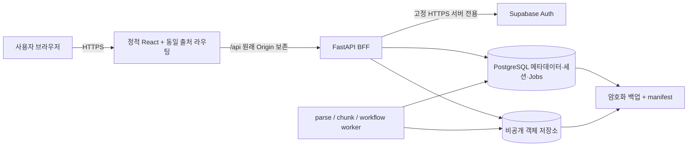

# 서무ITDA 인터넷 배포 아키텍처·실행 계획

작성일: 2026-10-18 KST. 상태: **설계 제안, 리소스 미생성·외부 호출 미실행·공개 배포 불가**. 사용자 승인 범위는 현황 보존과 계획 수립이다. 인간 판정 0/10·전체 0/40을 유지하며 정답 승인과 배포 준비는 별도 트랙이다.

## 1. 결론과 기준 정합

ARCHITECTURE.md의 기존 **Vercel 정적 React + Render FastAPI/독립 worker + Supabase PostgreSQL/Auth/private Storage**를 우선 권장한다. 시연 기간에는 API와 worker를 상시 실행하고, 하나의 HTTPS 사이트에서 `/api`를 백엔드로 프록시한다. 다른 제품 스택으로 교체하거나 SQLite 파일을 여러 서비스에 복사하여 운영하지 않는다.

이 계획은 G1-C 통과나 배포 승인이 아니다. PRD FR-01/05/07/08/14/15/18, NFR의 보안·영속성·원본 보존, WEB 인증/원문/실패 복구를 적용한다. 실제 LLM·임베딩, 한컴 시각 검증, 인간 의미 정확도, 전체 P0 및 G1-D 공모전 제출 조건은 여전히 미완료다. 오프라인 MVP 인터넷 시연은 그 한계를 명시해야 하며 전체 PRD 완료로 표현하지 않는다. 기존 문서의 과거 '원격 없음' 등 시점 기록은 과거 사실로 보존하며 현재 Git 상태는 이 보고를 따른다.

## 2. 현재 코드에서 확인한 배포 차이

| 영역 | 실제 현재 상태 | 필요한 변경/검증 |
|---|---|---|
| React | Vite 정적 build, `/api` 기본, `credentials:same-origin` | 같은 공개 출처 `/api` rewrite, SPA fallback, private cache 금지, 보안 헤더 |
| API 시작 | `apps.api.main:app`, parsing 켬, root 기본 `work/phase2a/runtime` | strict 운영 설정 loader/앱 factory, readiness, fail-fast; 현재 환경 변수만 넣어서는 연결 안 됨 |
| DB | Repository/AuthStore/작업/비용 원장에 SQLite 직접 SQL·BEGIN IMMEDIATE | PostgreSQL 어댑터·명시 migration·락/lease/unique 동등성; URL 치환만으로 이식 불가 |
| 원본 | LocalOriginalStore, UUID key, 배타 생성·chmod·read SHA 검사 | private 객체 저장 adapter, 덮어쓰기 방지·read SHA·metadata 대사·실패 보상 |
| 인증 | 고정 HTTPS Supabase transport와 서버 `/user` 검증, mock 회귀 완료 | 운영 config wiring·초기 멤버십 provisioning·실계정 연결은 별도 승인 후 |
| 세션 | SQLite 세션/멤버십 재검사, HttpOnly/Secure/SameSite=Lax·CSRF·Origin | 공유 PostgreSQL 이전, proxy 호스트/IP 신뢰, 공급자 중지/세션 폐기 정책 |
| worker | parse/chunk/workflow 3개 CLI, 각 `--institution-id`/로컬 data-dir 필요 | PG/Storage 주입, 기관별 공정 스케줄러, supervisor/독립 프로세스와 graceful shutdown |
| 검색 | literal 기본, C는 서버 flag+명시 strategy | PG 검색 어댑터 동등성 필요. 이번 계획에서 FTS/벡터 기본 교체 안 함 |
| LLM | FakeTransport만 허용, real_calls_enabled는 Literal[False] | 실전송은 차후 별도 구현·모델/자료/예산 승인. 키 주입만으로 활성화 불가 |
| health | `/health`에 local_only/public_deployment_ready=false 명시 | 운영 liveness/readiness를 구분하고 DB/worker 상태 확인; 거짓 ready 변경 금지 |

근거 파일: apps/api/{main,repository,auth,auth_store,storage,supabase_transport,provider_safety,provider_budget,worker,chunk_worker,workflow_worker}.py, apps/web/src/{auth/AuthContext,api/documents,api/workflows}.tsx 또는 .ts, apps/web/vite.config.ts. Vite dev/preview proxy는 운영 프록시가 아니다. 20MiB 업로드는 apps/api/formats.py의 실제 한도지만 proxy body/time 제한도 별도 실증해야 한다.

## 3. 구성 비교와 비용 가정

이번 작업은 외부 API/웹 요청을 하지 않았다. 아래는 **구매 견적이 아닌 예산 계획 범위**이며 2026-10-18 현행 가격·약관·지역 제공 여부를 실시간 확인하지 않았다. 계정 생성 전 공식 가격표와 무료 플랜 제한·비상업적 이용 조건·카드 요구·세금·환율·초과 과금을 확인한다. 공급자별 확정 단가로 인용하지 않는다.

| 구성 | 월 예산 가정(USD, AI·세금 별도) | 장점 | 시연/운영 위험 |
|---|---:|---|---|
| 무료 정적 호스팅 + 무료 API/DB + worker 필요 시 수동 실행 | 0–10 | 개인 개발 확인 | sleep/cold start·DB pause·상시 worker·백업 보장 부족. 무인 공모전 시연/장기 운영 비권장 |
| **Vercel + Render API/worker + Supabase** | **55–120**, frontend 유료 필요 시 총 **75–140** | 기존 기준안 일치, 관리형 HTTPS·DB·Auth·객체 저장, 독립 worker | PG/객체 adapter 선행, egress/업로드 proxy 한도, 서비스 수·메모리 과금 |
| 저가 VM + reverse proxy + API/worker + 관리형 PG/Auth/객체 | 40–90 | 고정 실행·proxy body 제어, 한 worker 호스트에 여러 프로세스 | 패치/방화벽/TLS/프로세스/장애 복구 직접 관리. 운영 책임자 필요 |
| Cloud Run + Jobs/Tasks + 관리형 PG/Auth/객체 | 30–100+ | 컨테이너·사용량 기반 확장 | idle worker polling 과금/CPU 정책, job dispatch 신규 구현, 제출 직전 변경 위험 |

권장안 예산 분해(확정 단가 아님): 정적 0 또는20, API 7–25, worker 호스트/서비스 합계21–60, DB/Auth/Storage 기본25 전후, 독립 백업/알림2–10, 합계55–120 정도. 실제 필요 메모리와 플랜 최소가격이 범위를 벗어날 수 있다. 하나의 worker 호스트에 3개 프로세스를 supervisor로 묶는 비용 절감안은 **미구현**이다. 분리 3서비스이면 각 서비스별 상시 비용을 합산한다. worker 기관별 프로세스 수 증가도 비용에 반영한다. 도메인 연10–30은 별도 가정이다.

시연 예산 승인 요청 시 월 상한 예: 인프라100, 초과 시 신규 등록/분석 중단, 기존 읽기 유지. 이 수치는 **미승인 제안**이다. 공급자 budget 알림은 hard stop이 아니므로 autoscale 최대치·egress cap 가능 여부·앱 quota를 함께 확인한다. 신규 staging DB 프로젝트·서버를 계속 켜면 별도 비용이 발생한다. 임시 staging 운용 기간과 삭제 가능한 파생 리소스만 미리 정하고 원본 자동 삭제는 금지한다.

확인할 공식 페이지(이번 미조회): https://vercel.com/pricing , https://render.com/pricing , https://supabase.com/pricing , https://cloud.google.com/run/pricing . 특히 Vercel 플랜의 프로젝트 이용 자격과 외부 rewrite의 body/timeout/Set-Cookie 지원을 실제 선택 플랜에서 확인한다. 제한이 20MiB raw 업로드와 충돌하면 **운영 전** 단일 front proxy(예: 관리 VM Caddy/Nginx)에서 정적 파일과 API를 같은 출처로 제공하는 대안을 평가하고 ARCHITECTURE의 변경 이유를 기록한다. 이를 이유로 무단 cross-origin cookie 변경이나 업로드 계약 축소를 하지 않는다.

## 4. 권장 통신·인증 구조



- 브라우저에는 Supabase provider token/DB키/Storage관리키/LLM키를 전달하지 않는다. 외부 API hostname을 VITE_API_BASE_URL에 넣는 것만으로는 현재 same-origin 쿠키가 전송되지 않는다.
- 공개 호스트 하나(예: app.example.org, 예시일 뿐 생성 안 함)의 `/api/*`를 API의 `/*`로 전달한다. `/api`가 SPA fallback으로 빠지지 않도록 우선 처리한다. 깊은 프런트 URL은 index.html fallback. backend 원본 URL도 같은 인증·Origin 정책을 적용하고 private ingress 가능 여부를 확인한다.
- proxy는 Set-Cookie 여러 헤더·__Host 쿠키(Path=/, Secure, Domain 미설정), Origin, CSRF 헤더, raw upload Content-Type·길이를 보존한다. 인증/문서 응답 cache 금지, service worker 민감 캐시 금지. 세션 고정 방지/로그아웃/원문 다운로드/20MiB/timeout을 staging에서 확인한다.
- 실제 Supabase 로그인은 기존 password 교환 → 서버 `/auth/v1/user` 확인 방식을 유지한다. 별도 미검증 JWT decode를 신원 인증으로 추가하지 않는다. OAuth/PKCE·MFA·초대 메일은 현재 구현된 것으로 표시하지 않는다.
- 서버 issuer+subject의 identity, active institution·membership·role만 권한에 사용한다. metadata나 요청 institution/role로 권한 상승 금지. 현재 한 사용자 active membership 정확히 1개 계약 유지. 다기관 사용자 선택은 별도 기능이다.
- 초기 운영 관리자 identity/기관/membership은 인증된 운영 절차로만 provisioning한다. 공개 signup 금지/초대 전용을 우선 계획한다. 테스트 seed/MockProvider/dependency override는 운영 이미지·entrypoint에서 차단한다. publishable/legacy anon은 로그인 gateway용이며 **service_role은 SupabaseSettings에 넣지 않는다**.
- 공급자 계정 정지와 로컬 세션의 즉시 동기화는 현재 없다. 로컬 비활성화·세션 revoke로 즉시 차단, 공급자 이벤트/주기적 재확인·최대TTL 정책은 구현·검증 필요. 삭제/탈퇴·복구도 로컬 데이터 및 계정 절차와 대사한다.
- HTTPS managed cert, HTTP redirect, 검증 후 HSTS, CSP/frame-ancestors/nosniff/referrer-policy, 명시 trusted hosts/proxy hops. IP rate-limit이 proxy 전체를 한 사용자로 보거나 임의 X-Forwarded-For를 신뢰하지 않게 검증한다. 인증·검색·업로드·비용 quota도 운영 공유 저장소로 처리한다.

## 5. DB·worker·객체 영속성

PostgreSQL 이식 범위는 documents/versions/events/upload_intents, source_blocks/parse_jobs, chunks/chunk_jobs, workflows의 jobs/generations/candidates/review_issues/form_links, identities/memberships/organizations/sessions/challenges/login_limits/audit 및 별도 provider_budget 원장이다. 현재 비용 DB는 provider_budget 전용 테이블만 허용하므로 애플리케이션 DB로 무조건 합치지 않는다. PG 전용 스키마/별도 role 또는 별도 DB로 동등한 격리를 설계한다.

SQLite row/placeholder/DDL/PRAGMA/INSERT OR REPLACE/락 동작을 PostgreSQL에 맞게 명시 변경한다. SQL이 service에 존재하는 부분도 포함해 조사한다. 단순 Repository 클래스 교체만으로 완료되지 않는다. lease claim은 transaction + row lock/SKIP LOCKED 또는 동등 원자 UPDATE, idempotency unique constraint, 만료시 token fencing·heartbeat·최대재시도를 보존한다. 비용 예약은 institution/job unique와 잠금으로 동시 초과·중복 차감을 막는다. DB migration lock과 스키마 버전 검증 후 구버전 worker가 쓰지 못하도록 한다.

API/worker는 같은 DB와 private bucket을 사용하되 별도 최소권한 role이다. 문서별 기관/활성버전/parse attempt/chunk generation/원본 SHA 및 EvidenceRef를 저장 직전 다시 검사한다. 조회 가능한 세대로의 원자 전환은 공식 승인/게시가 아니다. NOT_VERIFIED/NOT_REQUESTED 유지. 서비스 role이 RLS를 우회할 수 있으므로 RLS만으로 보호된다고 주장하지 않는다. 일반 DB 클라이언트 role은 최소권한/RLS 또는 강제 tenant filter를 적용하고 다른 기관 API/worker/job 접근을 부정 시험한다. 브라우저에서 DB 직접 접근은 제공하지 않는다.

private object UUID key/원 SHA와 위치를 보존하는 adapter를 추가한다. key 이전·원본 이동이 필요한 migration은 별도 범위 승인 후만 수행한다. 개발 원본은 이동/삭제하지 않고 승인된 합성 자료의 별도 복제 및 manifest부터 검증한다. 업로드는 immutable conditional create, upsert 금지, DB intent → object write → DB committed와 orphan 대사로 부분 실패를 복구한다. Storage/DB 사이 전역 원자 트랜잭션은 없음을 인정한다. SHA mismatch/없는 object는 fail closed, overwrite 원천 차단 기능의 실제 지원을 확인한다. 다운로드는 서버 권한 검증 후 stream 우선; signed URL을 쓰면 짧은 TTL/최소범위·로그 금지 및 등록 해제 이후 잔여 유효성을 별도 해결한다. public bucket 금지.

각 worker는 별도 프로세스로 재시작 정책, graceful drain, visibility/lease, timeout, 자원 제한을 갖는다. workflow watchdog의 os._exit는 실행 프로세스를 종료하므로 API와 한 프로세스로 합치지 않는다. 현재 --institution-id 고정 worker를 신규 기관까지 자동 지원한다고 가정하지 않는다. 첫 시연은 운영자가 provision한 기관 allowlist만, 추후 공정 dispatch를 별도 구현한다. idle 0.5초 polling은 PG connection/query 비용을 늘리므로 backoff/notification은 동등성 시험 후 적용한다.

## 6. 백업·복구·운영 기준 제안

- 목표: 시연 단계 RPO24시간/RTO4시간, 심사 직전 매 릴리스/시연 시작 전 snapshot. 장기 RPO1시간·PITR은 플랜/별도 비용 검증 후 결정한다. 현행 보장 수치가 아니다.
- DB 논리/플랫폼 백업과 원본 객체 별도 백업·객체 SHA manifest를 같은 cutoff에 연결한다. Supabase DB 백업이 Storage 바이너리를 포함한다고 가정하지 않는다. 버킷 설정·권한·migration 버전·비용 원장도 별도 기록한다.
- 암호화된 독립 보관처/접근권한·키 복구를 준비한다. 예: daily7/weekly4 보존 제안이며 용량과 원본 보존 정책 승인 필요. 자동 원본 영구삭제는 없다. 기존 ARCHITECTURE의 제출 후 보관 제안을 확정 정책으로 바꾸지 않는다.
- 복구 리허설은 새 격리 환경에서 schema→DB→object manifest→lease reconcile→기관/버전/EvidenceRef/hash→해제 tombstone 순서로 확인한다. 복원 시 기존 세션 전체 폐기, 처리 중 작업은 이전 fencing token을 무효화 후 재시도, 미확정 비용은 보수적으로 reconcile하여 중복 비용/출력 방지. Supabase Auth 계정·issuer/subject의 복구와 앱 membership 대사도 별도 확인한다.
- release artifact/DB schema compatibility, expand/contract migration, feature flag off, 새 job 중지·worker drain 뒤 이전 artifact rollback. DB/원본을 과거 상태로 무조건 덮어쓰는 rollback 금지.
- 알림: API 오류율/latency, worker heartbeat·queue age·만료 lease, DB connection/용량, object 오류/hash mismatch, 백업 age/복구 결과, 비용 예약 잔액. 로그는 request/job/institution의 비민감 ID와 코드만, 원문/질문/이메일/password/token/signed URL 금지. 민감 API access log querystring도 제거한다.

## 7. 설정 계약과 계정

**현재 이름이 존재하는 것과 차후 추가할 loader를 구분한다.** `.env.example`에 적힌 변수가 모두 현재 실행 코드에 연결된 것은 아니다.

| 설정 | 배치 | 실제 적용 상태/정책 |
|---|---|---|
| VITE_API_BASE_URL=/api | 프런트 build 공개값 | 현재 지원. 비밀 금지 |
| SB_ENABLE_SCORED_OR_SEARCH=0 | API 서버 | 현재 지원. 기존 literal 기본 유지 |
| AuthSettings(origin,secure_cookie,ttl,idle) | 서버 factory | 현재 Python 주입 지원. 운영 origin HTTPS·Secure true; TTL1800/idle900 기본 확인 |
| SupabaseSettings(project_url,api_key,timeout_seconds) | 서버 factory | 현재 Python 주입 지원; 고정 project.supabase.co HTTPS만, gateway key 서버 전용 |
| APP_ENV, DATABASE_URL, DB_POOL_URL | API/worker secret store | 예제/설계 또는 새 loader 필요. direct migration URL과 pooled runtime URL 분리, TLS verify·pool 총합 제한 |
| APP_ORIGIN, TRUSTED_PROXY_HOPS, PORT | 서버 | 운영 loader/호스트 제한 제안. ALLOWED_ORIGINS 예제와 단일 origin 매핑을 명시할 것 |
| SUPABASE_PROJECT_URL, SUPABASE_AUTH_API_KEY | API | 새 loader 변수명 제안, 기존 설정 객체에 매핑. 이름만 넣어도 활성화 안 됨 |
| STORAGE_URL, STORAGE_BUCKET, STORAGE_SERVER_KEY | API/worker | 새 객체 adapter/loader 필요. Storage 관리키는 Auth gateway키와 분리, 브라우저 미노출 |
| LLM_PROVIDER, 모델/EMBEDDING_* 및 API key | 차후 승인된 서버/worker만 | 현재 실전송 불가. 런타임 활성화 구현은 별도 작업 |
| PAID_CALLS_APPROVED=false, 예산/토큰/timeout/retry | 차후 공급자 loader | 예제 변수만으로 현재 Fake 전용 차단을 해제하지 못함. 미승인 유지 |

필요 계정: GitHub 해당 저장소 읽기/배포권한, 선택한 정적 호스트·API/worker 호스트, Supabase 조직/프로젝트 관리자, 도메인/DNS 관리, 독립 백업 저장소·알림 수신자. 최소권한·운영자 MFA·복구 담당자 2인 권장. production/staging 프로젝트/키/bucket/DB/user를 분리한다. 기존에 계정이 있는지는 이번 확인하지 않았으며 없다고 단정하지 않는다. 실제 secret 값은 플랫폼 secret manager로만 입력하고 채팅/Git/.env 첨부 금지. build time에는 server secret을 주입하지 않는다. Git 연동은 원치 않는 push 자동 배포가 켜지지 않도록 수동 release부터 계획한다.

## 8. 설치·구현·배포 실행 순서

**이번 실행하지 않은 향후 runbook**이다. 현재 소스용 개발 설치 명령은 아래와 같다. Linux Python3.12.14·Node24.19.0/npm11.9.0의 기존 환경을 기준으로 한다.

```bash
python3.12 -m venv .venv
.venv/bin/python -m pip install -r requirements-api-lock.txt -r requirements-parsing-lock.txt
npm --prefix apps/web ci
npm --prefix apps/web run typecheck
npm --prefix apps/web run build
```

기존 로컬 entrypoint `.venv/bin/python -m uvicorn apps.api.main:app --host 127.0.0.1 --port 8000`는 deny-all/SQLite 기본이다. 이를 운영 명령이라고 제공하지 않는다. worker 기존 CLI는 `.venv/bin/python -m apps.api.worker --data-dir <로컬경로> --institution-id <기관ID>`와 chunk_worker/workflow_worker다. 현재 --data-dir를 cloud URL로 바꿀 수 없다.

1. 현재 변경 보존·검토 가능한 diff, 권장 공급자/리전/월 상한/도메인/실인증 시험 계정·데이터 범위 결정. 가격·약관은 승인 후 확인. 실제 리소스 신청·키 등록·공개 배포는 각 승인 필요.
2. 아래 '다음 구현 단위' 순서로 strict config/DB/Storage/worker 준비. 현재 잠금 의존성·파서·RAG/EvidenceRef 계약 보존. 공급자 SDK/PG driver 추가는 버전·라이선스·재현 검사.
3. 운영과 분리된 staging 리소스·비공개 bucket·TLS/role·secret 준비는 승인 후. 명시 migration runner로 신규 빈 schema 생성, 버전/호환 검증. 아직 runner/운영 entrypoint는 없으므로 존재하지 않는 명령을 만들지 않는다.
4. 합성 corpus만 복제/해시 검증·기관/identity/membership provisioning. 실제 내부/개인 자료 금지. 원본 기존 위치 유지. 백업/복원 리허설.
5. API 배포/readiness → 독립 worker 3종/heartbeat → 같은 출처 정적 frontend/proxy → HTTPS/security header 순으로 연결. 실행 이미지는 commit SHA/lockhash로 pin, runtime 임시 디스크에 영속 저장 금지.
6. 승인된 실제 Auth 최소 시험 + 기관 A/B·reader/manager 부정 시험, 재배포·작업중단·lease recovery·20MiB/raw 업로드·CSRF/Origin/cookie·로그아웃 차단·backup restore·한도/장애 시험. 실제 LLM/embedding은 여전히 off.
7. TEST_PLAN 전체 backend/UI/타입/build/실제 HTTPS E2E·PC/mobile를 새 실행하고 G1-C 결과 보고. 성능/콜드스타트/예산까지 통과해야 사용자에게 최종 공개 배포 승인을 요청한다. 심사 G1-D는 별도다.
8. 승인 이후만 공개 DNS/접근권한 전환 및 smoke. 자동 merge나 main push는 하지 않는다.

## 9. 향후 LLM·임베딩

공급자별 endpoint allowlist/HTTPS/리다이렉트 금지/timeout/429·503 bounded retry/스키마·EvidenceRef 재검증은 기존 Fake 계약을 재사용한다. 실제 전송 클래스는 별도로 구현하며 WorkflowExtractionAdapter와 LLMAdapter.generate 반환형을 합치지 않는다. public/synthetic 문서 allowlist+전송 manifest, 모델 ID/가격 버전/지역·보관·학습이용조건을 승인받는다. 임의 사용자 첨부의 '공개' 문자열만으로 외부 전송 승인하지 않는다.

요청/작업/기관/전체 월 상한, 모든 retry의 최악 토큰 예약, 원자 reserve→usage reconcile→release/charge, 중복 job key, 응답/청구 불명 시 보수적 예약 유지, 재시작 대사·kill switch를 PG에서 검증한다. 별도 **$3/$10/$30은 과거 제안이지 현재 지출 승인 아님**. 예상비용 식은 (입력tokens×입력단가 + 출력tokens×출력단가)/1e6 + embeddingtokens×단가/1e6 + retry 여유. 검증 전 실제 단가·토큰을 측정치로 쓰지 않는다. 임베딩은 모델/차원/세대 pin과 기관/버전 필터, 재색인 원자전환 필요. 인프라 준비와 인간 골드 검토는 병렬 가능하지만 미검토 골드 의미 합격·실AI 정확도는 선언하지 않는다.

## 10. 다음 구현 단위와 수용 기준

| 순서 | 작은 구현 단위 | 완료 기준 |
|---|---|---|
| 1 | **운영 설정·시작 계약 + 오프라인 배포 사전 검사** | production에서 Mock/SQLite/로컬영속/잘못된 origin/빠진 secrets 차단, 값 로그 없음, 미설정 deny-all 유지. 운영 entrypoint·health/readiness 명시, 테스트는 Fake만 |
| 2 | PostgreSQL repository/auth/job/budget adapter·migration | 새 격리 로컬 PG에서 동일 회귀, 동시 claim/lease/fencing·예산·기관·rollback·migration복구. 외부서비스 호출 없음 |
| 3 | private object adapter·intent 대사·백업/복구 도구 | Fake/로컬 호환 저장소로 immutable/hash·고아복구·타기관·등록해제·restore manifest 시험 |
| 4 | worker runtime/프로세스 감독·같은 출처 proxy 배포 산출물 | 종료/재시작/heartbeat/세기관 공정성·헤더/cookie·업로드 계약 로컬 통합. 실제 배포 안 함 |
| 5 | 승인된 staging 실증 | 계정/비용/실Auth/비공개 외부자료 전송/도메인·공개 범위를 승인한 뒤 G1-C 실제 시험 |

1단계를 다음 개발 요청으로 권장한다. 이번 작업에서는 구현을 시작하지 않았다. 구성비교 결과만으로 현재 제품·DB·인증 기본값을 변경하지 않는다.
